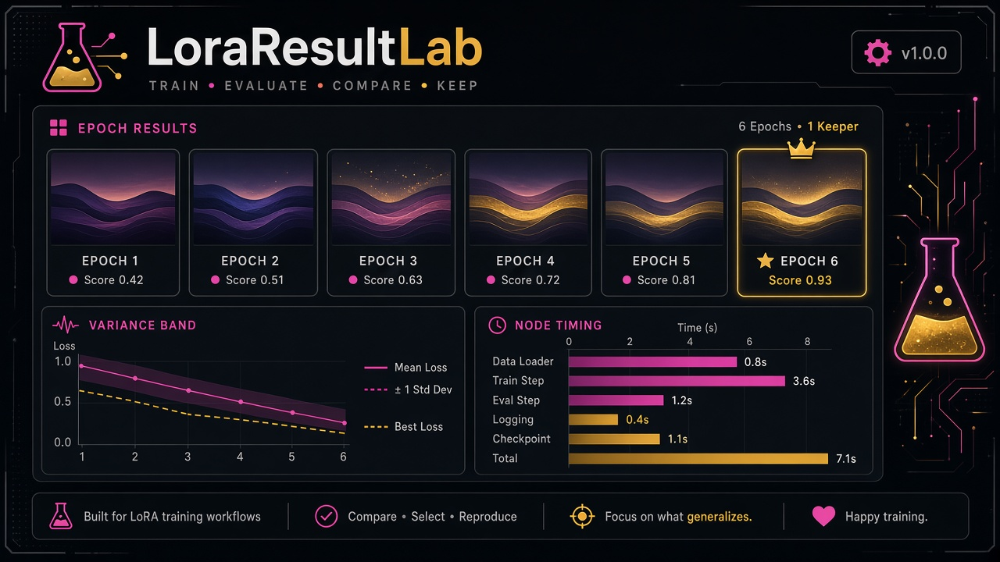
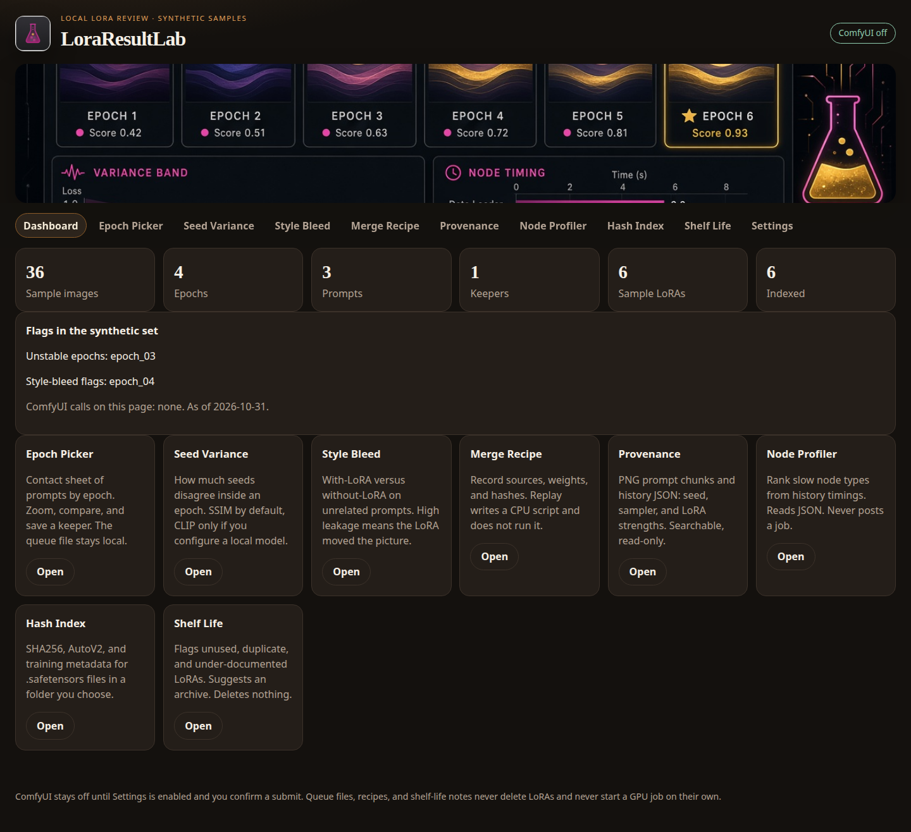
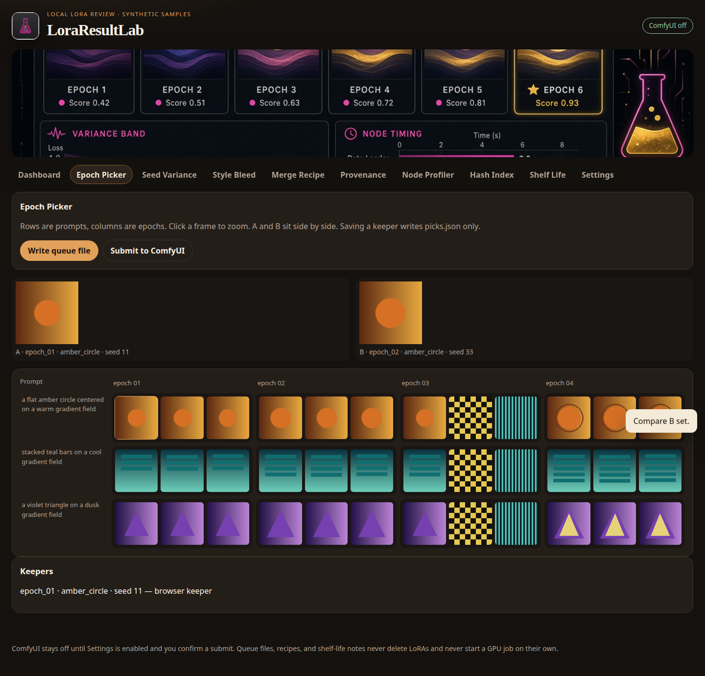
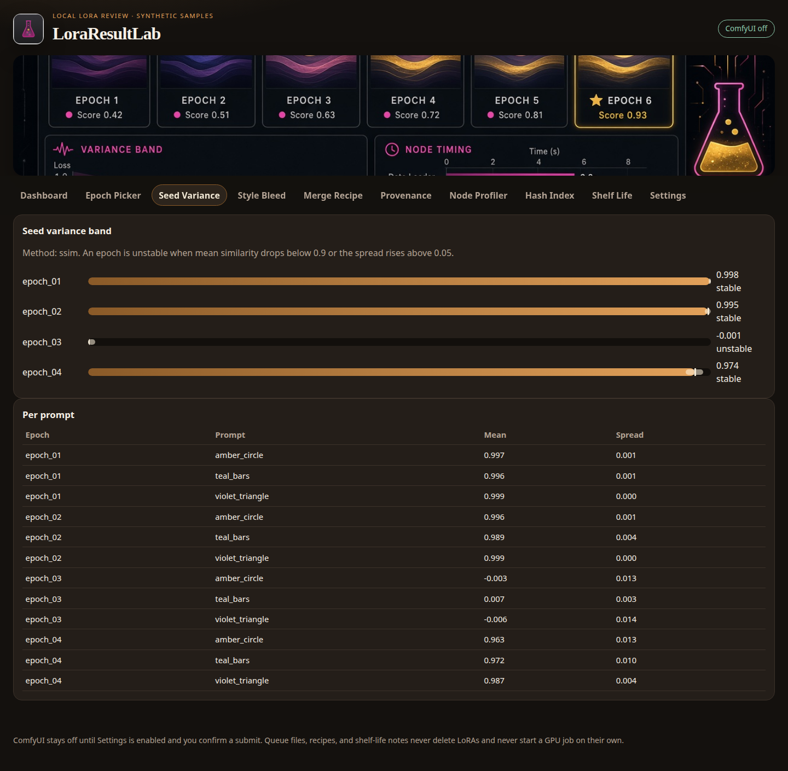
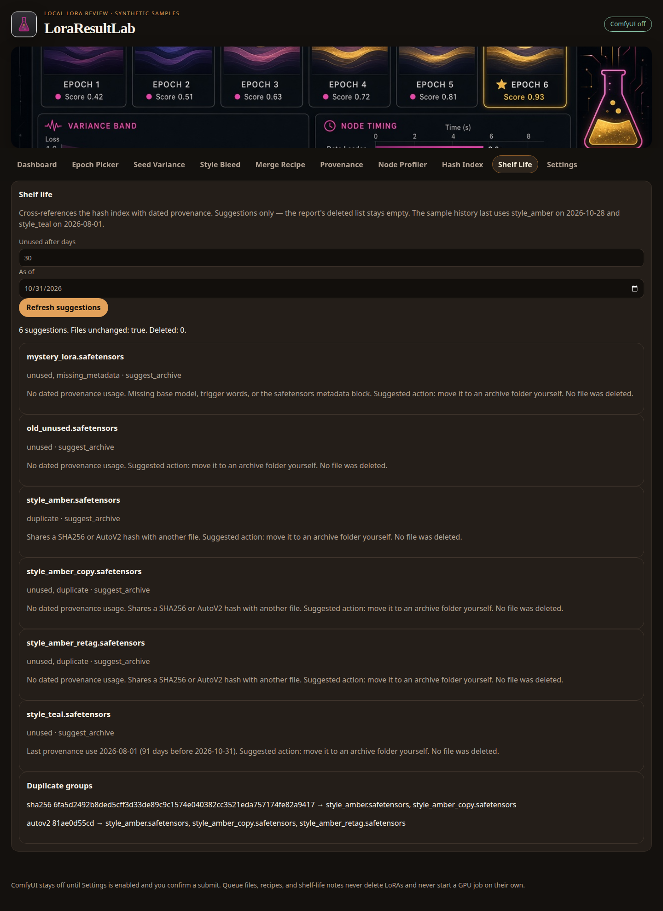
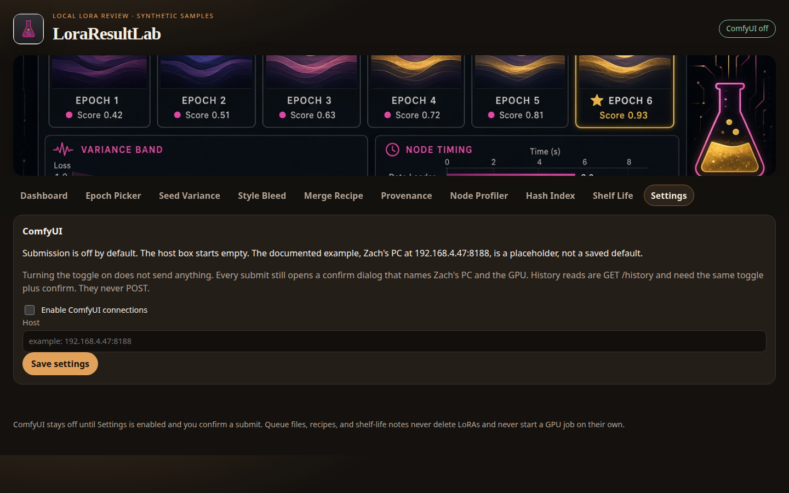

# LoraResultLab



LoraResultLab is a local app for judging and organizing LoRA training results. It reads images you already have, ComfyUI metadata, and `.safetensors` files on disk. It does not connect to ComfyUI unless you turn that on and confirm the action.

The sample set is synthetic: gradients and geometric shapes, fake PNG text chunks, a fake history file, and tiny dummy LoRA files. There are no photographs of people and no secrets.

## What you can do

| Module | What it does |
| --- | --- |
| Epoch Picker | Contact sheet of prompts by epoch. Zoom, A/B compare, save a keeper with notes to `picks.json`, or write a queue file. |
| Seed Variance | Similarity across seeds in each epoch (SSIM by default). Mean and spread, with unstable epochs flagged. |
| Style Bleed | With-LoRA versus without-LoRA on unrelated prompts. Leakage is `1 − similarity`. |
| Merge Recipe | Record sources, weights, hashes, and a method as YAML. Replay writes a CPU script and does not run it. |
| Provenance | PNG `prompt` / `workflow` text and history JSON: seed, sampler, LoRAs, and strengths. Searchable. |
| Node Profiler | Ranks the slowest node types and ids from history timings. Read-only. |
| Hash Index | SHA256, AutoV2, and training metadata (`ss_*`, base model, trigger words) in SQLite. |
| Shelf Life | Unused LoRAs, hash duplicates, and missing metadata. Suggests an archive. Deletes nothing. |









## Safety

ComfyUI is off by default.

- The host field starts blank. `192.168.4.47:8188` is the documented example for Zach's PC. It is a placeholder, not a saved default, and the app never dials it on its own.
- Epoch Picker either uses images already on disk or writes `data/queue/epoch_queue.json`. Writing that file does not submit it.
- **Submit to ComfyUI** stays behind Settings. Turning the toggle on still sends nothing. Every submit opens a confirm dialog that says the job runs on Zach's PC and uses that PC's GPU. Cancel sends nothing.
- Provenance and Node Profiler read a file you upload, or the synthetic history. **Fetch /history** is a single `GET /history` and only runs after the toggle is on and you confirm. Those tools never `POST`.
- Merge Recipe replay writes a Python script and a command file. It does not execute them and it does not select a GPU. **Run CPU merge** is a separate button, stays on this machine, and refuses anything other than CPU.
- Shelf Life and the hash index never delete `.safetensors` files. Shelf Life only suggests moving something to an archive.



The server binds to `127.0.0.1` only.

## Quick start

Each launcher creates `.venv`, installs `requirements.txt`, starts the app, and opens a browser at `http://127.0.0.1:8765`.

**macOS** — double-click `launch-mac.command`. If macOS blocks it, right-click the file, choose Open, and confirm. Or in Terminal:

```bash
./launch-mac.command
```

**Windows** — double-click `launch-windows.bat`.

**Linux**:

```bash
./launch-linux.sh
```

From a checkout, without the launcher:

```bash
python3 -m venv .venv
source .venv/bin/activate
python -m pip install -r requirements.txt
python -m app
```

On Windows PowerShell, activate with `.venv\Scripts\Activate.ps1` instead of `source`.

The header uses `art/icon.png`. The banner uses `art/cover.png`. Both are also the favicon and the README images.

Optional CLIP similarity is off unless you install `torch` and `open_clip_torch` yourself and set `LORALAB_CLIP_MODEL` to a model that is already on disk. The app will not download weights. With that unset, Seed Variance and Style Bleed use SSIM.

## Sample data

`sample_data/` is generated by `python scripts/generate_samples.py`.

- Training grid: 4 epochs × 3 prompts × 3 seeds. Epoch 3 is intentionally unstable (checkerboard and stripes).
- Bleed pairs: unrelated grid and dot prompts, with and without a LoRA, at epoch 1 (almost the same) and epoch 4 (a loud color wash).
- `sample_data/history/history.json` dates `style_amber` on 2026-10-28 and `style_teal` on 2026-08-01.
- `sample_data/loras/` has an exact duplicate, a same-weights retag (AutoV2 match, different SHA256), a file with no metadata, and a LoRA that never appears in history.

Shelf Life evaluated on 2026-10-31 flags teal as unused (91 days), the unused and mystery files, and the duplicate group. `style_amber` itself was used recently, so it is flagged only as a duplicate. Nothing is deleted.

## Tests

```bash
python -m pytest
```

The suite covers the contact sheet and queue file, variance and bleed math, recipe round-trip, PNG and history parsing, node ranking, SHA256 and AutoV2, shelf-life flags, a UI smoke test, and the rule that no ComfyUI HTTP call happens unless the settings toggle and a boolean confirm are both set. GitHub Actions runs the same suite on push.

## Layout

```
app/                 FastAPI app, modules, and the web UI
sample_data/         synthetic images, history, and LoRAs
art/                 icon.png and cover.png
docs/screenshots/    UI captures
launch-mac.command   macOS launcher
launch-windows.bat   Windows launcher
launch-linux.sh      Linux launcher
```

Runtime files (`data/settings.json`, `data/picks.json`, the queue, recipes, and `catalog.sqlite`) stay in `data/` and are not part of the sample set.
